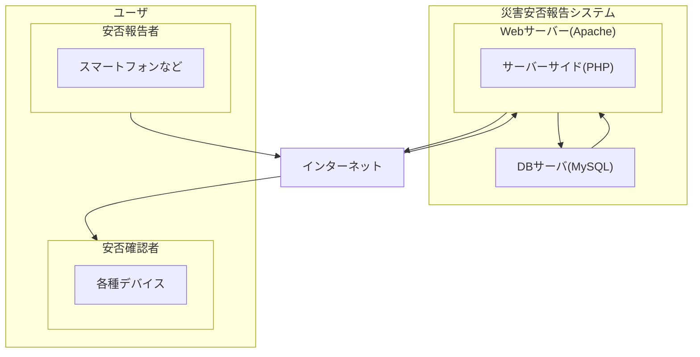

# SystemDev_TeamL

## システム開発授業のためのリポジトリ

本リポジトリはシステム開発授業のソースコード管理のためのリポジトリです。念のための履歴等管理用リポジトリとなります。基本的にはTeamsでのコード共有方針です。

## ディレクトリ構成

### チームディレクトリ（初回ガイダンス資料参照）

```

01_plan(企画書)
└── 要件定義段階の企画書ドキュメント等を作成する 
02_document(設計・共有資料) 
└── README.mdやリサーチ資料等 
03_report(発表資料) 
└── (プレゼン者のスライド等) 
04_project(作品データ) 
└── 後述

```

#### 04_project
※仮構成なので変更可能性あり
レスポンシブ対応

```

web 
├── html 
├── css 
└── js 
android 
├── html 
├── css 
└── js 
backend(共通システム) 
├── php 
└── db

```

## システム機能一覧と実装目安について

### 技術スタック（予定）

| **技術名**    | **内容**               |
| ---------- | -------------------- |
| HTML       | 表示処理                 |
| CSS        | スタイリング               |
| JavaScript | 動的なWebサイト作成（必要に応じて）  |
| PHP        | データベースとの連携、サーバーサイド処理 |
| MySQL      | データベース               |

## システム構成




