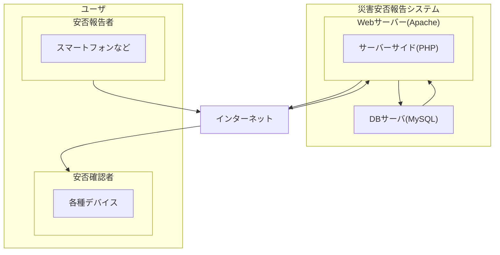

# SystemDev_TeamL

## システム開発授業のためのリポジトリ

本リポジトリはシステム開発授業のソースコード管理のためのリポジトリです。念のための履歴等管理用リポジトリとなります。基本的にはTeamsでのコード共有方針です。

## ディレクトリ構成

```

web
├── 01_pages
│   ├── html
│   │   ├── login.html(ログイン画面)
│   │   ├── safety
│   │   │   ├── safety_register.html(安否登録画面)
│   │   │   ├── safety_list.html(安否一覧画面)
│   │   │   ├── safety_detail.html(安否詳細画面)
│   │   │   └── safety_delete.html(安否削除画面)
│   │   └── admin
│   │       ├── admin_menu.html(管理者用メニュー画面)
│   │       ├── employee_list.html(社員一覧画面)
│   │       └── employee_detail.html(社員詳細画面)
│   └── css
│       ├── master.css
│       └── login.css
└── 02_componets
    ├── html
    │   └── logout.html
    └── css
backend(共通システム)
├── 01_php
└── 02_db

```

## システム機能一覧と実装目安について

### 技術スタック（予定）

| **技術名**    | **内容**               |
| ---------- | -------------------- |
| HTML       | 表示処理                 |
| CSS        | スタイリング               |
| JavaScript | 動的なWebサイト作成（必要に応じて）  |
| PHP        | データベースとの連携、サーバーサイド処理 |
| MySQL      | データベース               |

## システム構成




